<h1 align="center">DeckStand</h1>

<b>Tvoj iPhone na nabíjačke ako ovládací panel pre Windows PC.</b> 
Klávesy na hry a Discord, hlasitosť každej aplikácie, Spotify, Netflix, Kodi, touchpad, soundboard 
a veľké hodiny, keď sa telefónu nedotýkaš. Bez appky z App Store, bez účtu, bez predplatného.

  

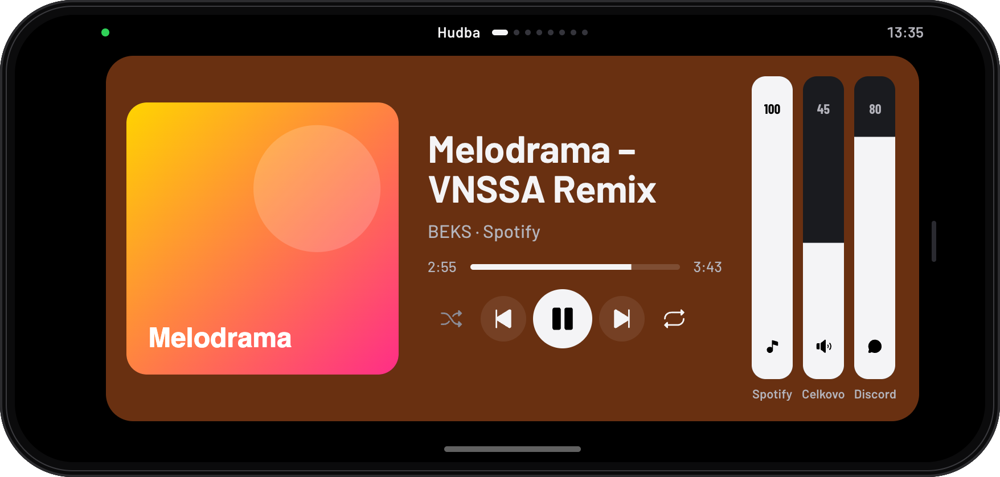

## Ako to funguje

Na PC beží malý program DeckStand (ikona v lište pri hodinách). Telefón sa s ním spojí cez domácu Wi-Fi
a otvorí sa ako appka na celú obrazovku. Telefón držíš **na šírku**: potiahnutím do strán meníš obrazovky,
potiahnutím zdola hore vysunieš klávesy. **Na výšku** sú nastavenia.

## Inštalácia (asi 2 minúty)

Potrebuješ PC s Windows 10 alebo 11 (64-bit) a iPhone na tej istej Wi-Fi.

1. **[Stiahni DeckStand.exe](https://github.com/xddvorak/deckstand/releases/latest/download/DeckStand.exe)** a spusti ho.
   Ak Windows napíše „Windows ochránil počítač“, klikni **Ďalšie informácie → Spustiť aj tak**
   (súbor nie je podpísaný platenou certifikačnou autoritou).
2. Potvrď okno **Kontrola používateľských kont** (Áno): DeckStand si povolí sieť vo firewalle.
3. Otvorí sa okno s **QR kódom**. Naskenuj ho fotoaparátom iPhonu a ťukni na odkaz.
4. DeckStand sa v Safari **spáruje sám**. Ťukni **Zdieľať → Pridať na plochu** a odteraz ho otváraj z plochy.
5. Otoč telefón na šírku. Hotovo.

DeckStand sa potom spúšťa sám po zapnutí PC. Ďalší telefón spáruješ pravým klikom na ikonu v lište
(**Spárovať telefón**); tam ho aj odinštaluješ, alebo v **Nastavenia → Aplikácie**.

## Čo vie

### Klávesy
Potiahni zdola hore a vysunie sa 15 kláves na stránku. Stránky prepínaš potiahnutím do strán alebo vľavo:
**Hranie** (Steam, Game Bar, klip, nahrávanie, snímka, časovače), **Discord**, **Systém** (okná, plochy,
schránka, výstrižok, prieskumník, zámok, uspanie, vypnutie), **Médiá**, **Netflix** a **Kodi**.
Hlasitosť a šípky sa opakujú, kým kláves držíš. Vypnúť a Uspať sa spustia až po podržaní, takže omylom nič nevypneš.

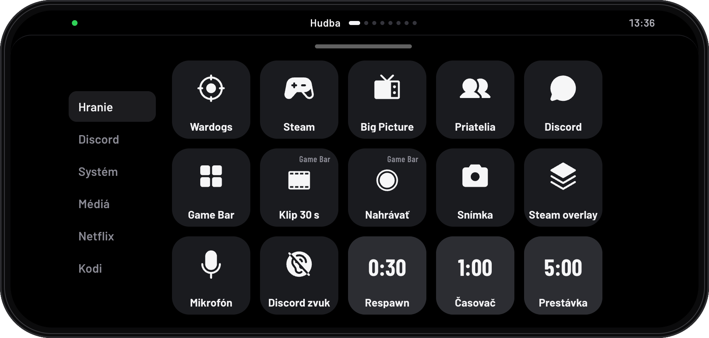 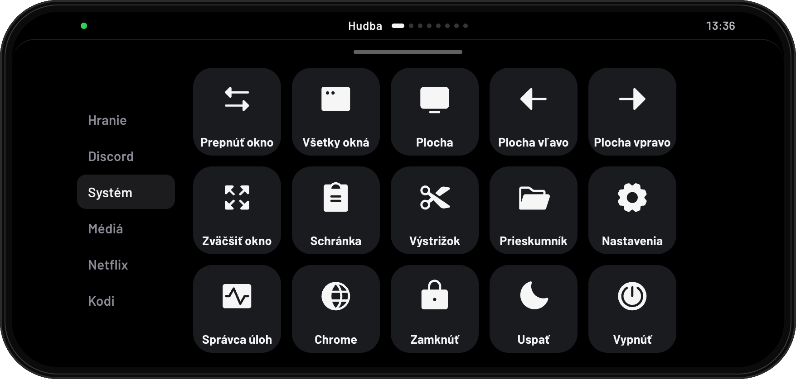

### Hudba a zvuk
Čo práve hrá (Spotify alebo čokoľvek v PC) s obalom albumu; pozadie sa zafarbí podľa obalu.
Hlasitosť sa ovláda posuvníkmi ako v Ovládacom centre iPhonu: potiahni kdekoľvek po pásiku,
ťuk na ikonu stlmí. Na obrazovke **Zvuk** má každá aplikácia vlastný posuvník (Spotify, Discord, hra,
prehliadač) a jedným ťuknutím prepneš výstup medzi slúchadlami a reproduktormi.

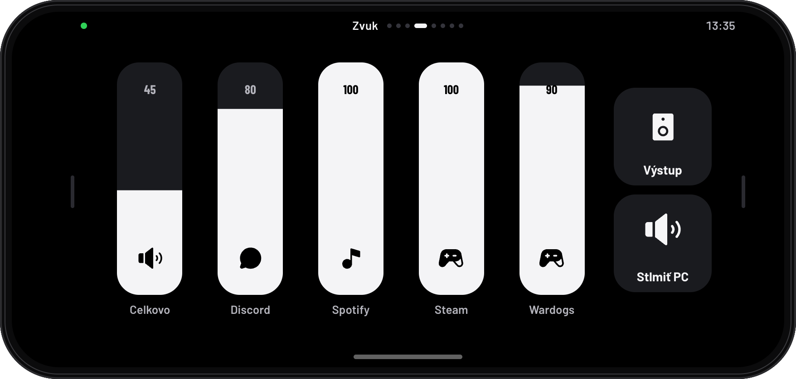

### Discord
Veľké tlačidlo mikrofónu stlmí mikrofón v celých Windows a svieti načerveno, keď je stlmený; pásik pod ním ukazuje,
či ťa práve počuť. Ďalej hlasitosť Discordu a citlivosť mikrofónu, stlmenie mikrofónu a zvuku priamo v Discorde,
Streamer mód a overlay.

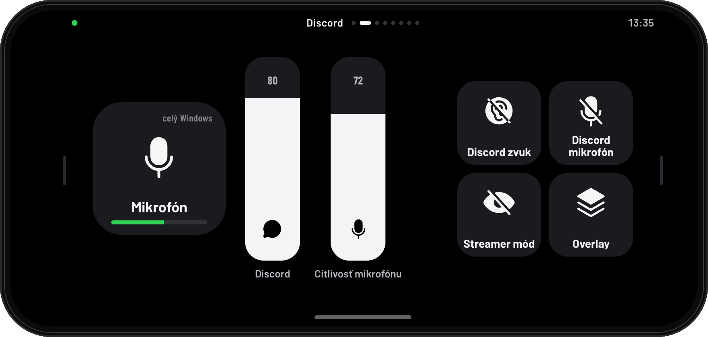

### Soundboard
Daj zvuky (mp3, wav, m4a) do priečinka a každý dostane svoje tlačidlo. Hrajú v tvojich slúchadlách a cez
virtuálny mikrofón ich počujú aj ostatní v hre alebo v Discorde (nastavenie nižšie).

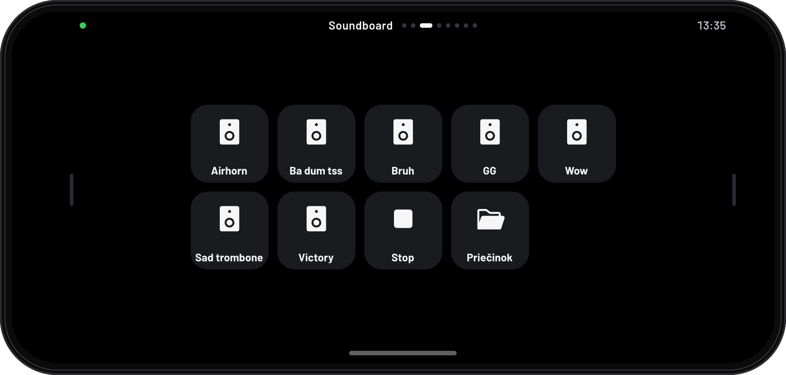

### Myš a klávesnica
Telefón ako touchpad: ťahaj prstom, ťuk je klik, dvoma prstami roluješ, ťuk dvoma prstami je pravý klik.
**Klávesnica** píše do PC každé písmeno hneď, aj s diakritikou.

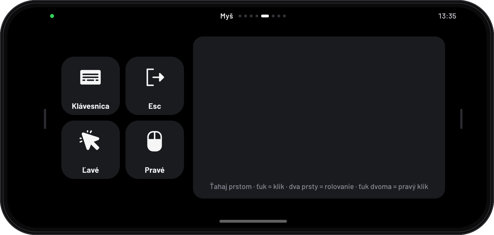

### Netflix a Kodi
Diaľkové ovládače. Pri Netflixe veľké **Preskočiť intro**, prehrávanie, ±10 sekúnd, hlasitosť a celá obrazovka;
klávesy idú vždy do okna s Netflixom, nikdy do hry. Pri Kodi šípky, OK, Späť, Domov, Info a prehrávanie;
po bloku šípok sa dá aj potiahnuť ako na ovládači televízora.
Keď je Netflix alebo Kodi na PC vpredu, DeckStand sa naň prepne sám.

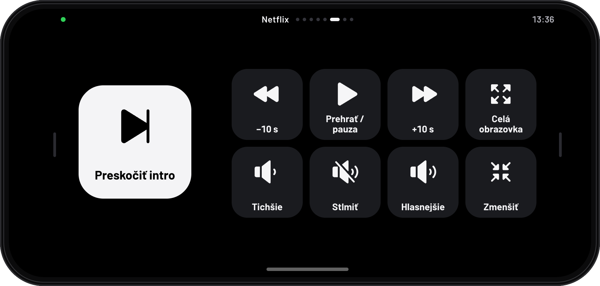 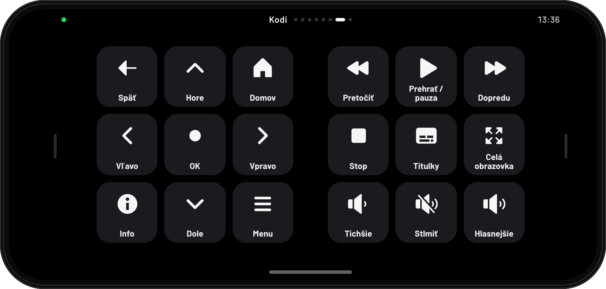

### Počítač a hry
Zaťaženie procesora a grafiky, teplota grafiky a pamäť; ukazovatele sa sfarbia, keď je PC naplno.
Keď spustíš hru, ktorá má vlastné rozloženie, DeckStand ukáže čas v hre a klávesy, ktoré v nej potrebuješ.

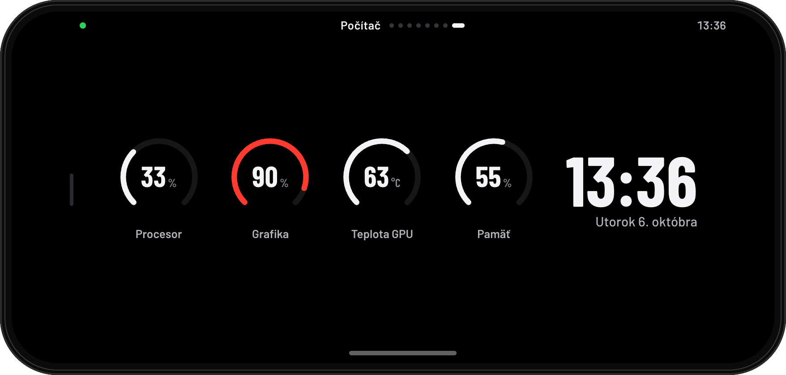 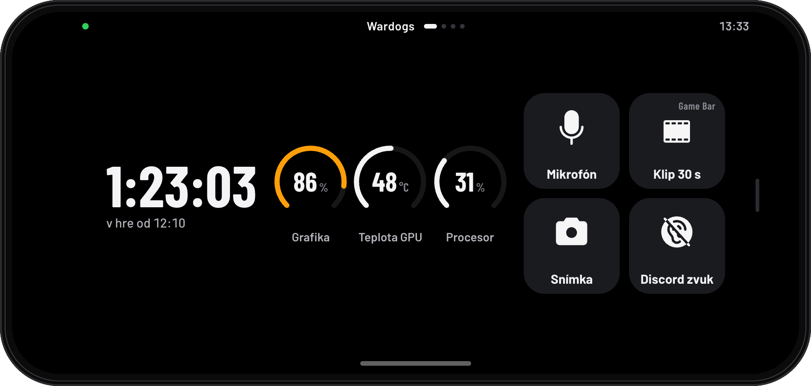

### Hodiny a hudobný režim
Keď sa telefónu chvíľu nedotýkaš, ukáže veľké hodiny (päť štýlov a osem farieb na výber) s dátumom,
zaťažením PC a tým, čo hrá. Ak hrá hudba, ukáže obal albumu a ovládanie. V noci len tlmené červené hodiny.
Obsah sa každú minútu jemne posunie, aby sa nevypaľoval do displeja.

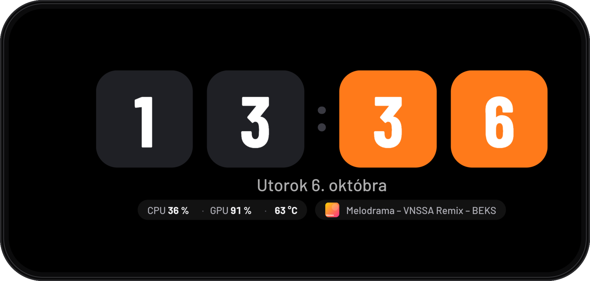 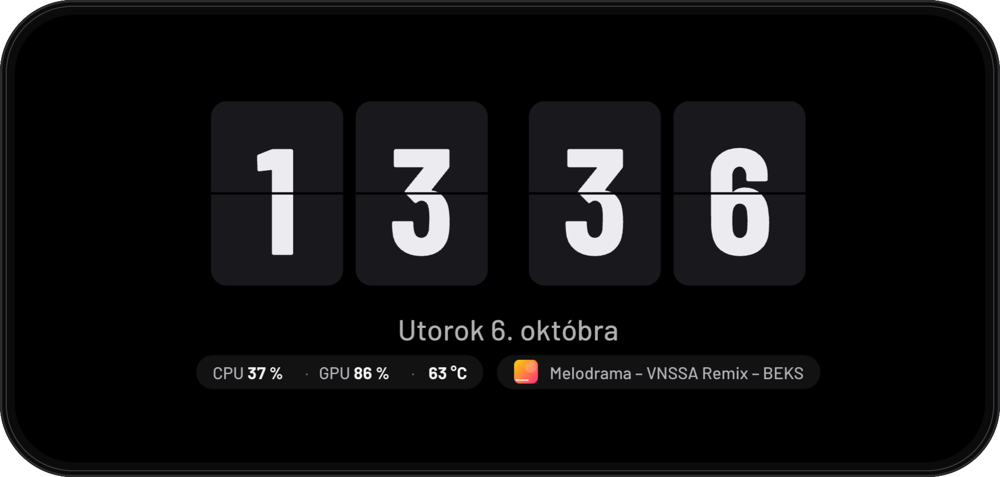

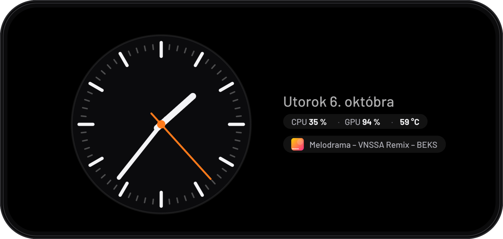 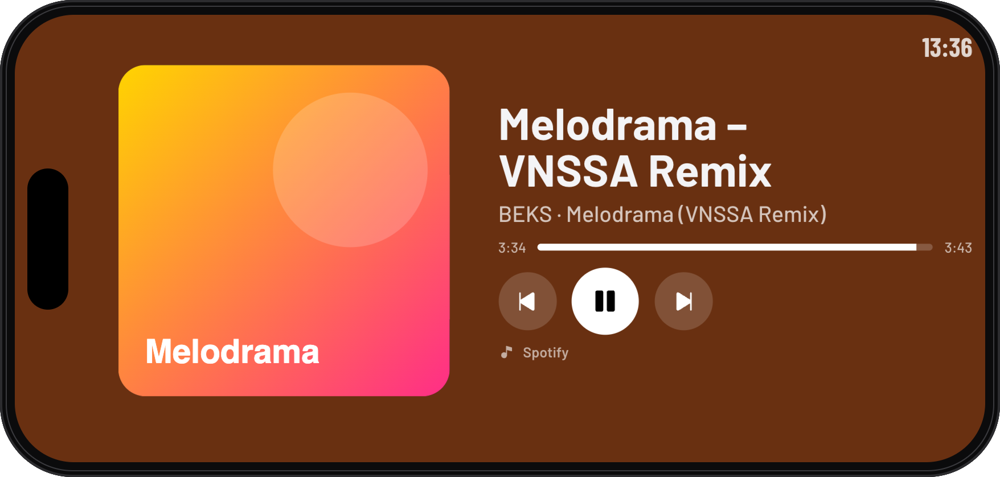

### Nastavenia
Otoč telefón na výšku: stav pripojenia, párovanie, kedy sa zapnú hodiny, ich štýl a farba, hudobný a nočný režim,
návody na Discord a soundboard.

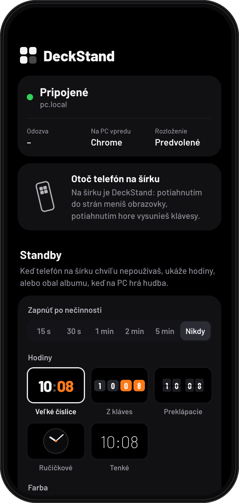

## Voliteľné nastavenie

**Discord: stlmenie jedným ťuknutím.** V Discorde otvor *Settings → Keybinds*, pridaj skratku
(*Toggle Mute*, *Toggle Deafen*, *Toggle Streamer Mode*, *Toggle Overlay*), klikni na nahrávanie skratky
a ťukni na príslušné tlačidlo v DeckStande. DeckStand posiela klávesy F13–F17, ktoré na bežnej klávesnici
nie sú, takže sa nebijú s hrami.

**Soundboard: aby zvuky počuli aj ostatní.**
1. Nainštaluj **[VB-Audio Virtual Cable](https://vb-audio.com/Cable/)** (zadarmo) a reštartuj PC.
2. Windows → Zvuk → Nahrávanie → tvoj mikrofón → Vlastnosti → Počúvať: zapni **Počúvať toto zariadenie** cez **CABLE Input**.
3. V Discorde alebo v hre nastav ako mikrofón **CABLE Output**.

## Časté otázky

**Funguje to aj mimo domu?** Nie, telefón a PC musia byť na tej istej Wi-Fi.

**Je to bezpečné?** PC ovládajú len spárované telefóny: párovací kód platí dve minúty a telefón dostane vlastný
kľúč, ktorý sa dá v lište kedykoľvek zrušiť. DeckStand prijíma spojenia len z domácej siete. Prenos v domácej
Wi-Fi nie je šifrovaný, preto ho nepoužívaj na verejnej sieti.

**Prečo Windows varuje pri spustení?** Súbor nie je podpísaný platenou certifikačnou autoritou; Windows takto
varuje pri každom novom programe od neznámeho vydavateľa.

**Android?** Mal by fungovať v Chrome rovnako (naskenuj QR, pridaj na plochu), no ladené je to na iPhone.

**Vypne sa displej telefónu?** Kým je DeckStand otvorený, drží displej zapnutý; telefón nechaj na nabíjačke.
Ak by predsa zhasínal, nastav v iPhone *Displej a jas → Automatické uzamknutie → Nikdy*.

Písmo Barlow (SIL Open Font License), ikony Phosphor (MIT) a Lucide (ISC).
